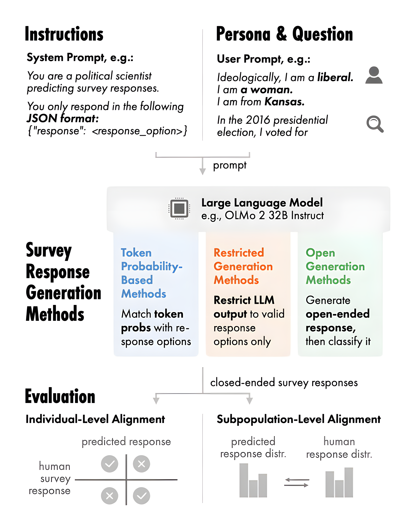
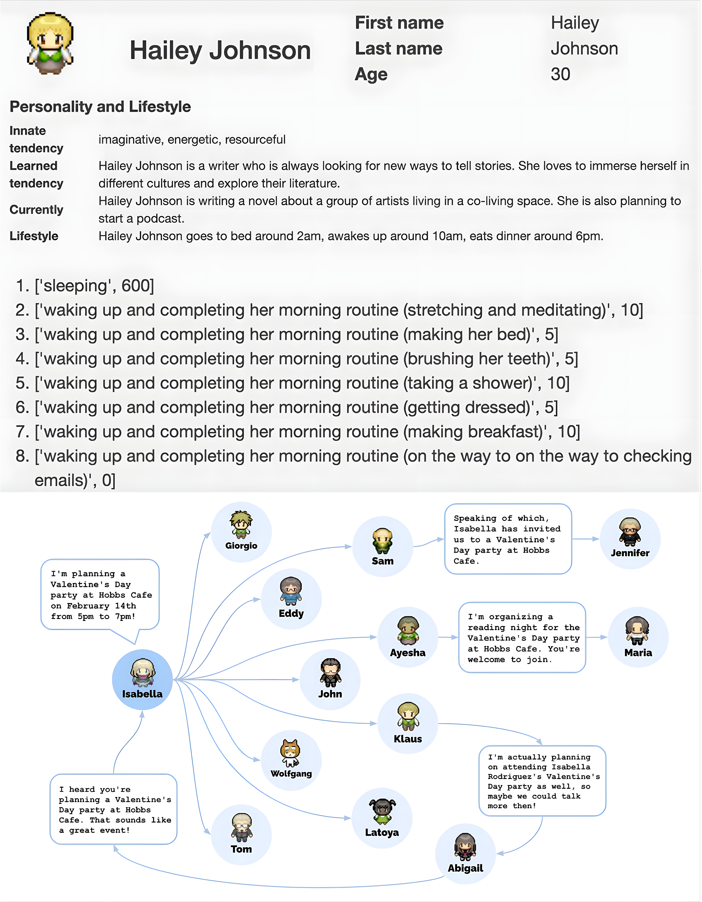

  
  

    <h1 style="font-family:'Noto Serif JP','Noto Serif SC',serif; font-size:55px; font-weight:800; color:#000; line-height:1.08; margin:0;">LLMs as Silicon Samples: Roles and Limitations</h1>
    
Graduate School of Arts and Letters, Tohoku University

    
Zeyu Lyu <a href="https://lvzeyu.github.io/" target="_blank" style="display:inline-flex; color:#6b7280;"><mdi-web style="font-size:20px;" /></a><a href="mailto:lyu.zeyu.e8@tohoku.ac.jp" style="display:inline-flex; color:#6b7280;"><mdi-email-outline style="font-size:20px;" /></a>

  

  

    LLMSS 2026 Round Table, City University of Hong Kong 
    14–16 October 2026
  

---

Role

## LLM Agents as a Silicon Sample

LLM agents show potential for simulating human responses in social surveys and experiments.

  <ul>
    <li v-click="1">Replicate the responses of human populations in social surveys
      <ul>
        <li>An LLM can be prompted to act as a respondent with specific demographic characteristics and generate consistent answers. (<a href="https://aclanthology.org/2026.acl-long.1927/">Ahnert et al., 2026</a>Ahnert, G., Haensch, A.-C., Plank, B., &amp; Strohmaier, M. (2026). Survey response generation: Generating closed-ended survey responses in-silico with large language models. <em>ACL 2026</em>., <a href="https://www.cambridge.org/core/journals/political-analysis/article/abs/out-of-one-many-using-language-models-to-simulate-human-samples/035D7C8A55B237942FB6DBAD7CAA4E49">Argyle et al., 2023</a>Argyle, L. P., Busby, E. C., Fulda, N., et al. (2023). Out of one, many: Using language models to simulate human samples. <em>Political Analysis</em>, 31(3), 337–351., <a href="https://www.cambridge.org/core/journals/political-analysis/article/synthetic-replacements-for-human-survey-data-the-perils-of-large-language-models/B92267DC26195C7F36E63EA04A47D2FE">Bisbee et al., 2024</a>Bisbee, J., Clinton, J. D., Dorff, C., et al. (2024). Synthetic replacements for human survey data? The perils of large language models. <em>Political Analysis</em>, 32(4), 401–416.)</li>
      </ul>
    </li>
    <li v-click="2">Generate human-like responses in social science surveys and psychological experiments
      <ul>
        <li>LLM predictions show high correlation with original treatment effects in social science experiments conducted with human population (<a href="https://www.nature.com/articles/s43588-025-00840-7">Cui et al., 2025</a>Cui, Z., Li, N., &amp; Zhou, H. (2025). A large-scale replication of scenario-based experiments in psychology and management using large language models. <em>Nature Computational Science</em>, 5, 627–634., <a href="https://www.nature.com/articles/s41586-026-10742-x">Hewitt et al., 2026</a>Hewitt, L., Ashokkumar, A., Ghezae, I., et al. (2026). Large language models can predict the results of social science experiments. <em>Nature</em>.)</li>
      </ul>
    </li>
  </ul>
  

    
  

LLMs as Silicon Samples: Roles and Limitations02

<!--

LLMs have opened up many new methodological possibilities for social science. In particular, LLM agents can serve as “silicon samples” to simulate human responses in surveys and experiments. 

[click] By assigning an LLM specific demographic or persona characteristics, researchers can prompt it to act as a particular type of respondent. We can then ask it the same questions used in social surveys and compare its responses with those of human participants. This allows us to examine whether the LLM produces answers that are consistent with its assigned characteristics.

[click] LLM agents can also participate in social surveys and psychological experiments as simulated subjects. Indeed, several studies have suggested that LLM agents can produce human-like responses in social surveys and experiments.
-->

---

Role

## LLM Agents in Social Simulation

LLM agents show great promise for social simulation by providing an efficient way to model heterogeneous individuals, generate realistic interactions, and explore complex social dynamics.

  <ul>
    <li v-click="1">LLM agents are promising for social simulation
      <ul>
        <li>Produce context-dependent, human-like behavior (<a href="https://arxiv.org/abs/2504.02234">Anthis et al., 2025</a>Anthis, J. R., Liu, R., Richardson, S. M., et al. (2025). LLM social simulations are a promising research method. <em>ICML 2025</em>., <a href="https://dl.acm.org/doi/10.1145/3586183.3606763">Park et al., 2023</a>Park, J. S., O'Brien, J. C., Cai, C. J., et al. (2023). Generative agents: Interactive simulacra of human behavior. <em>UIST 2023</em>.)</li>
      </ul>
    </li>
    <li v-click="2">Prompt-based application of LLM agents
      <ul>
        <li>Define agents' characteristics and behaviors through simple prompts</li>
        <li>Incorporate human-like cognitive processes such as memory, planning, and reflection through prompts (<a href="https://arxiv.org/abs/2305.10250">Zhong et al., 2024</a>Zhong, W., Guo, L., Gao, Q., et al. (2024). MemoryBank: Enhancing large language models with long-term memory. <em>Proceedings of the AAAI Conference on Artificial Intelligence</em>, 38(17), 19724–19731.; <a href="https://arxiv.org/abs/2210.03629">Yao et al., 2023</a>Yao, S., Zhao, J., Yu, D., et al. (2023). ReAct: Synergizing reasoning and acting in language models. <em>International Conference on Learning Representations</em>.; <a href="https://arxiv.org/abs/2305.04091">Wang et al., 2023</a>Wang, L., Xu, W., Lan, Y., et al. (2023). Plan-and-solve prompting: Improving zero-shot chain-of-thought reasoning by large language models. <em>Proceedings of ACL 2023</em>.; <a href="https://arxiv.org/abs/2303.17651">Madaan et al., 2023</a>Madaan, A., Tandon, N., Gupta, P., et al. (2023). Self-refine: Iterative refinement with self-feedback. <em>Advances in Neural Information Processing Systems</em>.)</li>
      </ul>
    </li>
  </ul>
  

LLMs as Silicon Samples: Roles and Limitations03

<!--
Recently, LLM agents have received increasing attention in social simulation.

[click] Basically, we begin by writing a prompt. For the simulation, we can define the agents’ profiles and characteristics and then ask the LLM to behave according to these definitions. The LLM will generate the agents’ actions, responses, and interactions based on the given prompts.

[click] Furthermore, we can write more detailed prompts to incorporate advanced features such as memory, planning, and reflection into an agent. These flexible, easy-to-implement techniques can make agents more human-like without requiring complex mathematical computations. Several previous studies have successfully used these techniques in simulations.
-->

---

Limitations

## Limitations of LLM Agents

Despite their promise, LLM silicon samples remain difficult to reproduce, control, and explain.

<v-clicks>

- Societal and representational biases
    - Explicit and implicit stereotypes related to race, gender, religion, and culture. (<a href="https://www.pnas.org/doi/10.1073/pnas.2416228122">Bai et al., 2025</a>Bai, X., Wang, A., Sucholutsky, I., et al. (2025). Explicitly unbiased large language models still form biased associations. <em>PNAS</em>, 122(8), e2416228122.; <a href="https://doi.org/10.1162/coli_a_00524">Gallegos et al., 2024</a>Gallegos, I. O., Rossi, R. A., Barrow, J., et al. (2024). Bias and fairness in large language models: A survey. <em>Computational Linguistics</em>, 50(3), 1097–1179.; <a href="https://arxiv.org/abs/2403.14727">Kotek et al., 2024</a>Kotek, H., Sun, D. Q., Xiu, Z., et al. (2024). Protected group bias and stereotypes in large language models. <em>arXiv</em>.)
    - Models are typically trained to be “helpful and harmless”, thus filter conflictual, aggressive, or “dark” social dynamics even when such behaviors are realistic and essential for understanding phenomena (<a href="https://www.pnas.org/doi/10.1073/pnas.2314021121">Bail, 2024</a>Bail, C. A. (2024). Can generative AI improve social science? <em>PNAS</em>, 121(21), e2314021121.; <a href="https://journals.sagepub.com/doi/10.1177/00491241251327130">Zhang et al., 2025</a>Zhang, S., Xu, J., &amp; Alvero, A. (2025). Generative AI meets open-ended survey responses: Research participant use of AI and homogenization. <em>Sociological Methods &amp; Research</em>.).

- Convergence toward the “Average Persona”
    - LLM agents may produce responses that are plausible on average but fail to capture the full heterogeneity of real human populations. (<a href="https://www.cambridge.org/core/journals/political-analysis/article/abs/out-of-one-many-using-language-models-to-simulate-human-samples/035D7C8A55B237942FB6DBAD7CAA4E49">Argyle et al., 2023</a>Argyle, L. P., Busby, E. C., Fulda, N., et al. (2023). Out of one, many: Using language models to simulate human samples. <em>Political Analysis</em>, 31(3), 337–351.; <a href="https://www.nature.com/articles/s42256-025-00986-z">Wang et al., 2025</a>Wang, A., Morgenstern, J., &amp; Dickerson, J. P. (2025). Large language models that replace human participants can harmfully misportray and flatten identity groups. <em>Nature Machine Intelligence</em>, 7, 400–411.; <a href="https://arxiv.org/abs/2506.19806">Wu et al., 2025</a>Wu, Z., Peng, R., Ito, T., et al. (2025). LLM-based social simulations require a boundary. <em>arXiv</em>.)

- Challenges in reproducibility and interpretability of LLM agents
    - Sensitive to the prompt formulation (<a href="https://arxiv.org/abs/2509.13397">Cummins, 2025</a>Cummins, J. (2025). The threat of analytic flexibility in using large language models to simulate human data. <em>arXiv</em>., <a href="https://aclanthology.org/2023.findings-emnlp.241/">Loya et al., 2023</a>Loya, M., Sinha, D., &amp; Futrell, R. (2023). Exploring the sensitivity of LLMs' decision-making capabilities: Insights from prompt variations and hyperparameters. <em>Findings of ACL: EMNLP 2023</em>.)
    - The black-box nature creates difficulties in verifying the reliability and validity of results.
</v-clicks>

LLMs as Silicon Samples: Roles and Limitations04

<!--
However, there are still several important limitations when we use them for social simulation.

[click] First, as you know, an LLM can have inherent biases. On the one hand, this raises doubts about whether LLM agents can accurately represent different types of people or are mainly effective at representing specific groups. On the other hand, because many models are trained to be helpful and harmless, they often avoid aggressive or harmful behaviors, even when these behaviors are important for understanding real social dynamics.

[click] Also, LLM agents often represent a kind of generalized or average person, while real social phenomena usually depend on heterogeneity and variation among individuals.

[click] Furthermore, an LLM also presents challenges for reproducibility and interpretability. A subtle change in the prompt can produce a very different outcome, and it is difficult to understand why because the model remains a black box when we rely only on prompts.
-->

